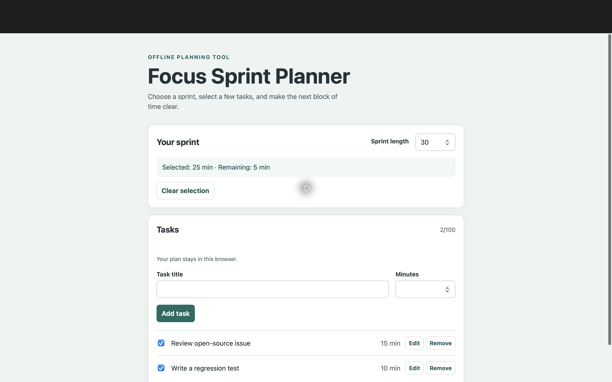

# Prepared public copy verification

Verified at 2026-10-13T17:32:53.361Z with Node.js v26.3.0 on darwin.

| Check | Result | Command |
| --- | --- | --- |
| Original tests | 13/13 passed | `node --test app.test.js` |
| Independent tests | 12/12 passed | `node --test verification/independent.test.js` |
| UI syntax | Passed | `node --check app.js` |
| Core syntax | Passed | `node --check core.js` |
| Pointer-target regression on previous source | Failed as expected | Targeted independent regression |

The independent suite covers complete create/select/edit/sprint/remove/clear persistence and reload, cancel, the 100-task capacity, invalid input, 1/480 minute boundaries, literal stored markup, prototype-like IDs, removal while editing, 500 deterministic malformed-state samples, both source manifests, local entrypoint resources, the sprint accessibility-marker regression, and retaining checkbox/Edit targets across sprint changes.

The prepared copy contains six app/documentation files and seven selected provenance files from the reviewed source. Before changes, all six copied files matched the supplied reviewed manifest. The original Copilot response has exactly those six expected filenames; all six original contents match the unchanged original manifest. The current reviewed manifest was updated after the sprint fixes and public-documentation cleanup. Raw sessions, login data, runtime logs, and event streams were not copied or inspected by the copy verifier.

The supplied prompt, original response, usage metadata, and provenance record are mutually consistent with Copilot source-text generation. This verifier did not operate Copilot or independently authenticate that session. The current code includes Codex revisions and tests, as described in `../evidence/PROVENANCE.md`.

The Safari reviewer reproduced lost first clicks when a changed sprint input blurred directly into a checkbox or Edit button. The sprint change handler now saves and renders only the summary, retaining task controls. The added regression fails on the previous reviewed app and passes on the prepared app. The subsequent native Safari retest also confirmed that the first checkbox and Edit clicks succeed, as recorded below.

The local tests execute the real app script in a DOM harness. They do not establish Safari layout, native controls, accessibility-tree behavior, or browser localStorage. Browser validation and any GHW acceptance receipt require separate evidence. This report does not claim public hosting, an accepted challenge submission, or awarded points.

Machine-readable commands, exit codes and source hashes are in `results.json`. Original and independent test outputs are in `original-tests.txt` and `independent-tests.txt`. The reviewed accessibility fix is in `sprint-validity.patch`; the previous pointer regression's expected assertion and status are in `pointer-regression-before.json`.

A public-file scan found no local user paths, the user's email address, common credential formats, private key blocks, or URLs containing embedded credentials. A final read-only comparison confirmed that all 13 selected source files remain unchanged in the source workspace.

## Native Safari validation

The Safari reviewer tested the final prepared app on 2026-10-13 UTC and supplied the following observed results. This copy verifier inspected the supplied screenshot; browser actions were performed by the Safari reviewer.

- Added “Review open-source issue” (15 minutes) and “Write a regression test” (20 minutes). Selecting both produced 35 minutes. Reload preserved the 45-minute sprint, both tasks, and both selections.
- Changed sprint 45 → 40 and immediately clicked a selected checkbox: the first click deselected it. Changed sprint 40 → 30 and immediately clicked the second task's Edit button: the first click opened the correct task. These retest both native blur/click regressions.
- Changed the second task estimate 20 → 10 and saved. Cancel discarded an unsaved title edit. Clear selection reset selected time to zero.
- Added and removed a temporary 5-minute task; the count returned to two and focus moved to a surviving checkbox. Space toggled the focused checkbox.
- Entered invalid sprint 0: the app restored 30 and displayed its explanatory error. Entered invalid task estimate 0: no task was added.
- Final reload preserved the two selected tasks, sprint 30, selected total 25, and remaining time 5. All task rows were visually reviewed.

The content-only screenshot shows the final state without account information, email, local paths, or browser URL chrome. It supports the visible layout and final values; it does not by itself prove every intermediate action.

